# ToleranceBandOracle: Intelligent Contract Primitive

> A decentralized, optimistic numeric oracle primitive built on GenLayer Intelligent Contracts that resolves live, fluctuating real-world integers using parameterized tolerance bands rather than strict equality.

---

## 1. Purpose

Smart contracts operating on live real-world metrics (e.g. spot token prices, gas fees, temperatures, live sports scores, follower counts) face a fundamental challenge under decentralized consensus: **live data fluctuates continuously**.

If an oracle network requires strict byte-for-byte or exact numerical equality (`strict_eq`), independent validators querying web APIs or scraping web pages with even a few milliseconds of latency will inevitably observe slight variations in live numbers, triggering consensus failure.

`ToleranceBandOracle` is a reusable **Contract Primitive** designed to resolve this:
- **Parameterized Tolerance**: Feeds specify an acceptable variance in basis points (`1..5000 bps`, i.e., `0.01% .. 50.00%`).
- **Equivalence Principle with Tolerance**: Validators independently fetch and extract the metric, accepting the leader node's proposal if and only if the absolute deviation falls within the allowable tolerance band:
  $$\left|\text{val}_{\text{validator}} - \text{val}_{\text{leader}}\right| \le \frac{\max(|\text{val}_{\text{leader}}|, 1) \times \text{tolerance\_bps}}{10\,000}$$
- **Optimistic Challenge Window**: Reports enter a `PENDING` state during which anyone can challenge the observation. Challenges re-run extraction under a **stricter tolerance** (half of the original). If the new consensus value deviates beyond the feed's original tolerance, the report is replaced and marked `CHALLENGED`.
- **Finalized Consumption**: Consumer contracts (escrows, prediction markets, parametric insurance) call `get_value(feed_id)` only after the challenge window elapses and the report is `FINALIZED`.

---

## 2. Feed & Report Lifecycle

```mermaid
stateDiagram-v2
    [*] --> Unregistered

    Unregistered --> Registered : register_feed(feed_id, url, instruction, tolerance_bps, challenge_secs)

    state Registered {
        [*] --> Idle
        Idle --> PENDING : report(feed_id) [Leader & Validators reach consensus within tolerance]
        
        state PENDING {
            [*] --> InChallengeWindow
            InChallengeWindow --> CHALLENGED : challenge(feed_id) [Deviation > original tolerance; value updated]
            InChallengeWindow --> InChallengeWindow : challenge(feed_id) [Deviation <= original tolerance; original kept]
        }

        PENDING --> FINALIZED : finalize(feed_id) [timestamp > reported_at + challenge_secs]
        CHALLENGED --> FINALIZED : finalize(feed_id) [timestamp > reported_at + challenge_secs]
    }

    state FINALIZED {
        [*] --> AvailableForConsumption
        AvailableForConsumption --> AvailableForConsumption : get_value(feed_id) [Returns verified int]
    }
```



---

## 3. How Consensus is Used

In GenLayer, Intelligent Contracts can execute non-deterministic actions (web fetching and LLM execution) inside consensus blocks governed by the **Equivalence Principle**.

Instead of delegating to a generic LLM wrapper, `ToleranceBandOracle` implements custom leader and validator logic via `gl.vm.run_nondet_unsafe`:

1. **Leader Execution (`leader_fn`)**:
   - The leader node fetches the target webpage using `gl.nondet.web.render(url, mode="html")` (with `gl.nondet.web.get` fallback).
   - Prompts the GenLayer LLM engine (`gl.nondet.exec_prompt`) with the feed's specific natural-language extraction instruction and the retrieved page content.
   - Defensively strips markdown fences (````json ... ````) and sanitizes currency signs, commas, or surrounding prose to extract a clean signed integer.

2. **Validator Verification (`validator_fn`)**:
   - Verifies the leader's proposal is a valid execution result (`isinstance(leader_res, gl.vm.Return)`).
   - Confirms the leader produced a parseable integer.
   - **Independently** re-fetches the URL and re-extracts the metric using the local validator's web and LLM pipelines.
   - Evaluates the numeric tolerance condition:
     ```python
     diff = abs(my_val - leader_val)
     base = max(abs(leader_val), 1)
     allowed = (base * tolerance_bps) // 10000
     return diff <= allowed
     ```
   - If the difference exceeds `allowed` or the leader's return was malformed, the validator rejects the proposal (`return False`), preventing malicious or out-of-band submissions from reaching state.

---

## 4. Why Tolerance Equivalence Beats `strict_eq` for Live Data

| Dimension | Strict Equality (`strict_eq`) | Tolerance Band Equivalence (`ToleranceBandOracle`) |
| :--- | :--- | :--- |
| **Volatile Financial Markets** | Fails frequently when quotes tick between asynchronous validator network requests. | Succeeds predictably (e.g. 50 bps tolerance accommodates typical tick drift). |
| **Dynamic Page Elements** | Fails if timestamps, ad scripts, or session tokens change the raw page response. | Succeeds because the LLM extracts the semantic metric, and validators compare the resulting integer. |
| **Extensible Precision** | All-or-nothing: zero variance permitted. | Configurable per asset class (e.g. 10 bps for stablecoins, 100 bps for volatile commodities, 300 bps for weather). |
| **Sybil Resistance** | Minor divergence halts the entire pipeline. | Optimistic challenge window allows disputing erroneous reports with a stricter 50% tolerance band. |

---

## 5. Usage Example: Composable Integration

To prove reusability across the GenLayer ecosystem, see [`contracts/example_consumer.py`](file:///contracts/example_consumer.py). A consumer contract connects to `ToleranceBandOracle` to settle conditional escrows or prediction markets:

```python
# { "Depends": "py-genlayer:1jb45aa8ynh2a9c9xn3b7qqh8sm5q93hwfp7jqmwsfhh8jpz09h6" }
from genlayer import *

class EscrowPredictionSettler(gl.Contract):
    oracle_address: Address
    feed_id: str
    target_threshold: bigint
    settled: bool
    outcome: bool

    def __init__(self, oracle_address: Address, feed_id: str, target_threshold: int):
        self.oracle_address = Address(str(oracle_address))
        self.feed_id = str(feed_id)
        self.target_threshold = bigint(target_threshold)
        self.settled = False
        self.outcome = False

    @gl.public.write
    def settle(self) -> bool:
        if self.settled:
            raise gl.vm.UserError("Escrow is already settled")
        
        # Inter-contract call to ToleranceBandOracle
        oracle = gl.get_contract_at(self.oracle_address)
        final_value = oracle.get_value(self.feed_id)
        
        self.outcome = bool(int(final_value) >= self.target_threshold)
        self.settled = True
        return self.outcome
```

### Complete End-to-End Workflow:
1. **Register**: Underwriter or feed creator registers `eth-spot-usd`:
   ```python
   oracle.register_feed(
       feed_id="eth-spot-usd",
       url="https://api.coinbase.com/v2/prices/ETH-USD/spot",
       instruction="Extract the current spot price of Ethereum as an integer",
       tolerance_bps=150,     # 1.5% tolerance
       challenge_secs=300     # 5-minute optimistic dispute window
   )
   ```
2. **Report**: An automated bot or user triggers `oracle.report("eth-spot-usd")`. Validators agree within 150 bps. Status is set to `PENDING`.
3. **Challenge (Optional)**: If the value reported was inaccurate due to temporary upstream issues, any participant calls `oracle.challenge("eth-spot-usd")` within 300 seconds.
4. **Finalize**: Once the 300-second window elapses, `oracle.finalize("eth-spot-usd")` locks the state to `FINALIZED`.
5. **Consume**: `EscrowPredictionSettler.settle()` executes cleanly without reverts.

---

## 6. Known Limitations

While `ToleranceBandOracle` provides resilient consensus for live metrics, developers deploying feeds should account for the following structural constraints:

1. **Upstream Source Manipulation & Flash Crashes**:
   - If an oracle feed relies on a single exchange API or unweighted spot orderbook, a localized flash-crash or illiquid wick at the upstream source could temporarily reflect a real-world value that deviates from market consensus.
   - *Mitigation*: Configure feeds to use aggregated index endpoints (e.g., CoinGecko, CoinMarketCap, or multi-exchange TWAPs) rather than single-venue order books.
2. **Single URL as a Single Point of Failure (SPOF)**:
   - If the registered target domain undergoes DNS downtime, 502 Bad Gateway outages, or Cloudflare bot challenges, validators will fail to retrieve page evidence, causing observation rounds to revert.
   - *Mitigation*: Use dependable endpoints with high uptime SLAs, or register multi-feed redundancy groups where a meta-consumer aggregates across 2 or 3 distinct feed IDs.
3. **Upstream Page Layout & DOM Mutations**:
   - For web-scraped targets (non-JSON APIs), major front-end redesigns or DOM changes may alter where metrics appear on the page.
   - *Mitigation*: Provide clear, semantic extraction directives in the `instruction` field (e.g. *"Extract the integer temperature value displayed in the 7-day forecast high for London"* rather than fragile CSS selectors).
4. **Integer Truncation & Decimals**:
   - The contract primitive standardizes on signed integers (`int`) to avoid floating-point non-determinism across disparate virtual machines. Sub-unit precision (e.g. cents or basis points) must be handled by scaling instructions (e.g. *"Extract price in USD cents"*).

---

## 7. Running Tests Locally

The contract includes a direct-mode mock runner compatible with standard `pytest` without requiring external binaries:

```bash
# Run complete test suite (10 test cases)
python -m pytest -v
```

Test coverage includes:
- `test_invalid_register_feed_inputs`: Validation of empty URLs, out-of-range bps, zero-length challenge windows, and duplicate feed registration.
- `test_consensus_reached_when_within_tolerance_band`: Two validators with divergent observations within the tolerance band reach agreement.
- `test_consensus_rejected_when_outside_tolerance_band`: Observation outside tolerance band is rejected by validator.
- `test_consensus_rejected_when_leader_returns_invalid_integer`: Rejects non-integer or malformed leader proposals.
- `test_defensive_markdown_and_format_parsing`: Validates JSON stripping, markdown fence removal, currency sign sanitization, and negative integer handling.
- `test_challenge_updates_value_when_divergence_exceeds_band`: Successful challenge round re-running with 50% stricter tolerance and replacing inaccurate report.
- `test_challenge_maintains_original_value_if_within_band`: Challenge within original band preserves initial report to avoid griefing.
- `test_finalize_reverts_before_window_closes`: Enforces strict time-lock verification on finalization.
- `test_get_value_fails_before_finalization`: Read-only view reverts on unfinalized reports.
- `test_example_consumer_settlement`: Verifies cross-contract integration and settlement with `EscrowPredictionSettler`.
